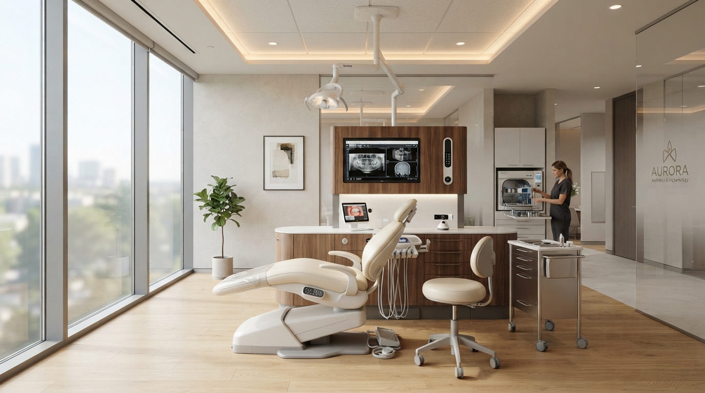

# 🦷 Bee Dental — Clínica Odontológica de Alta Precisión & Estética Dental

Sitio web oficial y sistema de agendamiento clínico para **Bee Dental**, diseñado con un enfoque estético de lujo médico, alta conversión y preparado para despliegue instantáneo en **Vercel**.



---

## 🌟 Características Principales

- **Diseño Médico de Alta Gama:** Paleta cromática médica de precisión (`#00685f`, menta esmeralda, acentos ámbar miel y blancos puros). Tipografía combinada *Playfair Display* (títulos de prestigio) y *Plus Jakarta Sans* (lectura clínica nítida).
- **Responsive 100%:** Navegación optimizada para móviles, tablets y pantallas de escritorio con menú off-canvas interactivo.
- **Hero & Propuesta de Valor:** Métricas de confianza (+12.000 sonrisas, 4.9★ con +850 reseñas Google, 15+ años de experiencia), insignias flotantes de *Escaneo 3D Sin Moldes* y *Experiencia Zero-Pain*.
- **Pabellón de Acreditaciones:** Certificaciones ISO 9001:2015, CAD/CAM 3D, Colegiación Oficial y financiación hasta 24 meses 0% de interés.
- **Catálogo de Especialidades Interactivo:**
  - Diseño de Sonrisa Digital (DSD)
  - Ortodoncia Invisible (Alineadores Transparentes)
  - Implantología Guiada en 24 Horas
  - Odontología Restauradora & Preventiva
  - Periodoncia y Terapia de Encías
  - Odontopediatría Amigable
- **Galería de Casos Clínicos (Antes y Después):** Transformaciones reales verificadas con tiempos de tratamiento y testimonios de pacientes.
- **Cuadro Médico Especialista:** Fichas profesionales con fotografía, credenciales, número de colegiado y trayectoria.
- **Formulario de Agendamiento Inteligente:**
  - Validación en tiempo real de campos (nombre, teléfono, correo, tratamiento y franja horaria preferida).
  - Al hacer clic en cualquier servicio del catálogo, el formulario se auto-selecciona con ese tratamiento y hace scroll suave con foco automático.
  - Confirmación con enlace directo a WhatsApp con mensaje pre-redactado con los datos de la cita.
- **Preguntas Frecuentes (FAQ Accordion):** Sección interactiva y accesible para despejar dudas comunes sobre la primera cita gratuita, financiación y sedación asistida.
- **Ubicación & Acceso:** Plaza Balón Ave, Av. Charles de Gaulle 10, Santo Domingo 11404, con acceso directo sobre la avenida, seguridad y estacionamiento reservado para pacientes, más mapa interactivo de Google Maps.
- **Botón Flotante de WhatsApp:** Conexión en 1 clic con el equipo de coordinación médica.
- **SEO & Datos Estructurados:** Schema.org (`Dentist`, `MedicalBusiness`), Open Graph y Twitter Cards completos para posicionamiento en Google.

---

## 🚀 Despliegue en Vercel (1 Clic)

Este proyecto está 100% optimizado para Vercel:

1. Ve a [Vercel](https://vercel.com) e inicia sesión con tu cuenta de GitHub.
2. Haz clic en **"Add New..."** → **"Project"**.
3. Selecciona el repositorio: `https://github.com/ylbani/bee_dental.git`.
4. Deja la configuración por defecto (Vercel detectará automáticamente la configuración de `vercel.json`).
5. Haz clic en **Deploy**. ¡Tu clínica estará online en menos de 30 segundos!

---

## 💻 Desarrollo Local

Para previsualizar o modificar localmente:

```bash
# Opción 1: Abrir directamente en el navegador
start index.html

# Opción 2: Con servidor local
npx serve .
# o
npm run dev
```

---

## ⚙️ Estructura del Proyecto

```text
├── index.html           # Landing page principal completa y estilizada
├── vercel.json          # Reglas de caché, cleanUrls y cabeceras de seguridad
├── package.json         # Configuración y scripts npm
├── DESIGN.md            # Especificaciones y tokens del sistema de diseño
├── screen.png           # Captura de referencia del diseño
├── logo.png / logob.png # Logotipos y recursos de la marca
└── README.md            # Documentación del proyecto
```

---

## 📞 Personalización de Contacto

Para cambiar el número de teléfono o WhatsApp de la clínica, busca y reemplaza en `index.html`:
- Teléfono actual: `+34 912 345 678`
- Enlace de WhatsApp: `https://wa.me/34912345678`
- Correo: `contacto@beedental.es`
- Dirección: `Plaza Balón Ave, Av. Charles de Gaulle 10, Santo Domingo 11404`

---

© 2025 Bee Dental S.L. Todos los derechos reservados.

